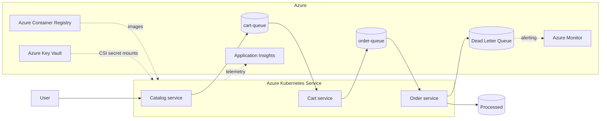

# ReadIt: Azure Microservices on AKS

ReadIt is a practical project for building and operating a small event-driven application on Microsoft Azure. It uses three .NET services, Azure Service Bus and Azure Kubernetes Service (AKS).

The work focuses on deploying the services, handling asynchronous messages, observing runtime behaviour and diagnosing failures. It is a learning project, not a production-ready reference platform.

## Architecture



### Services

| Service | Responsibility |
|---|---|
| Catalog | Receives requests and publishes messages |
| Cart | Consumes messages from `cart-queue`, validates/transforms them and forwards events |
| Order | Consumes messages from `order-queue` and processes orders |

The message flow is:

```text
User -> Catalog -> cart-queue -> Cart -> order-queue -> Order
```

Azure Service Bus provides the asynchronous communication between the services. The Cart service acts as an intermediate processor rather than requiring direct synchronous calls between every service.

## Azure infrastructure

Terraform is used to provision the main Azure resources through separate modules:

- Resource Group
- Azure Container Registry (ACR)
- Azure Kubernetes Service (AKS)
- Azure Service Bus namespace and queue

The AKS configuration uses a System Assigned managed identity. The kubelet identity receives the `AcrPull` role on the registry, allowing the cluster to pull container images without enabling the ACR admin account.

The supplied AKS variables define a default node count of two and a default VM size of `Standard_B2s`. The deployment manifests configure two replicas for Catalog, two for Cart and one for Order.

## Containers and Kubernetes

The three services are containerized and deployed to AKS.

The Kubernetes manifests define:

- Deployments for Catalog, Cart and Order
- Services using `LoadBalancer` or `ClusterIP`
- An NGINX Ingress resource for Catalog
- Read-only CSI volume mounts for secrets

The Catalog service manifest currently uses `LoadBalancer`, while an Ingress resource also routes traffic to that service. These are both present in the supplied configuration.

A `ClusterIssuer` using cert-manager's self-signed issuer is also defined. The supplied manifests do not establish that a TLS certificate is issued and configured on the Ingress.

## CI/CD

A GitHub Actions workflow runs on pushes to the `main` branch.

It performs the following steps:

1. Checks out the repository.
2. Authenticates to Azure using credentials stored as GitHub Secrets.
3. Logs in to Azure Container Registry.
4. Builds the Catalog, Cart and Order Docker images.
5. Tags each image with the Git commit SHA and pushes it to ACR.
6. Retrieves AKS credentials.
7. Updates the three Kubernetes Deployments with the new image tags.
8. Waits for the three rollouts to complete.

The workflow uses a service principal client secret stored in GitHub Secrets. Workload Identity Federation/OIDC is not configured in the supplied workflow.

## Messaging and failure handling

The application uses Azure Service Bus queues and a producer/consumer message flow.

Implemented handling includes:

- Retry handling for failed message processing
- Dead Letter Queue (DLQ) handling
- Poison-message scenarios
- Controlled failure simulation
- Correlation ID values in application logs
- Monitoring of DLQ activity

The project was used to investigate issues such as messages remaining in queues, consumers stopping, incorrect queue configuration, authentication failures and DLQ accumulation.

## Secrets management

Kubernetes workloads use the Secrets Store CSI Driver with the Azure provider.

A `SecretProviderClass` named `readit-secrets` references an Azure Key Vault and a User Assigned Managed Identity. The Catalog, Cart and Order Deployments mount the CSI volume read-only at `/mnt/secrets`.

The configured Key Vault objects are:

- `servicebus-connection`
- `servicebus-queue`
- `applicationinsights-connection`

The manifests show the identity reference and volume mounts. The associated Azure role assignments and Key Vault permissions must be configured separately for the identity to retrieve these secrets.

## Monitoring and troubleshooting

The project includes:

- Structured application logs
- Correlation ID logging
- OpenTelemetry instrumentation and custom spans
- Azure Application Insights integration
- Azure Monitor alerts
- DLQ and retry visibility

Troubleshooting work covered:

- Pods entering `CrashLoopBackOff`
- Kubernetes rollout and image-version inconsistencies
- `ImagePullBackOff` and registry access
- Missing secret configuration
- Service Bus authentication and queue configuration
- Consumers not processing messages
- DLQ accumulation
- Runtime and dependency compatibility problems
- OpenTelemetry package configuration

Example Kubernetes commands used during investigation:

```bash
kubectl get pods
kubectl get services
kubectl logs -l app=order -f
kubectl rollout status deployment/order-deployment
kubectl describe pod <pod-name>
```

## Repository layout

```text
readit-azure-architecture/
├── catalog-service/
├── cart-service/
├── order-service/
├── terraform/
├── kubernetes/
└── docs/
```

## Current scope and limitations

The project demonstrates the components and workflows described above. The following items are not implemented or are not complete in the current documented state:

- End-to-end distributed trace propagation across all services
- Centralized observability dashboards
- Comprehensive message schema validation
- Persistent idempotency handling
- Kubernetes autoscaling policies
- Service mesh integration
- Confirmed TLS certificate issuance and Ingress TLS configuration
- GitHub Actions authentication through OIDC / Workload Identity Federation

These are possible areas for further development.

## Documentation

Additional project material is maintained in the `docs/` directory:

- `architecture.md`
- `deployment.md`
- `testing.md`
- Monitoring and deployment screenshots
